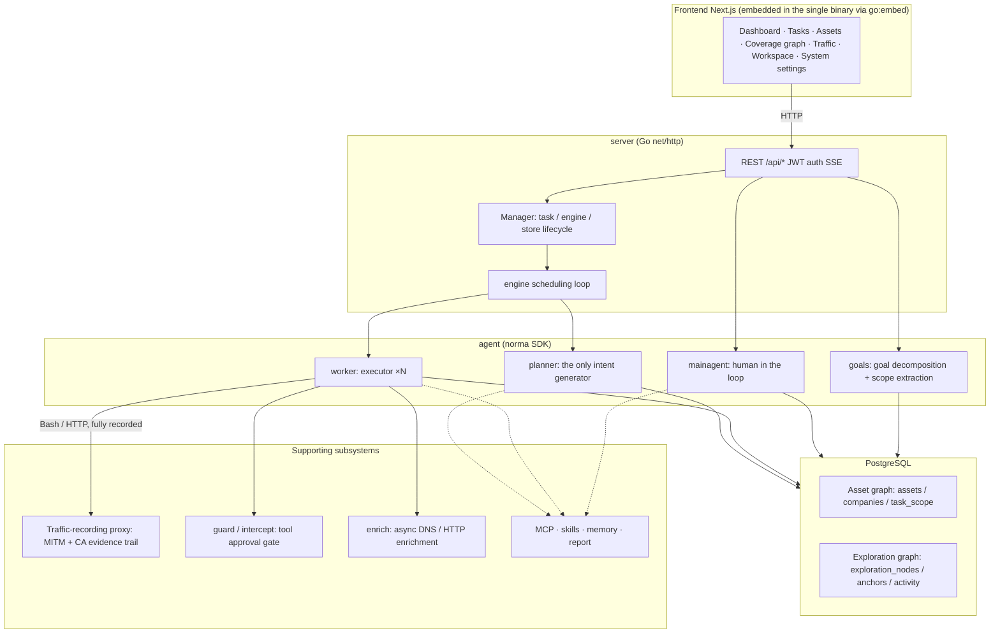
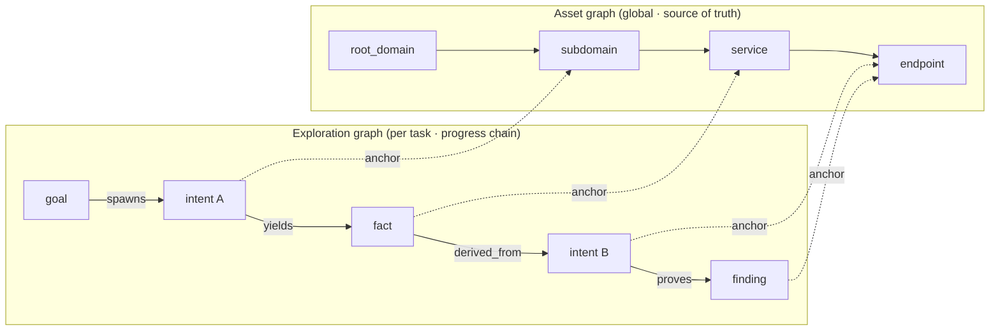
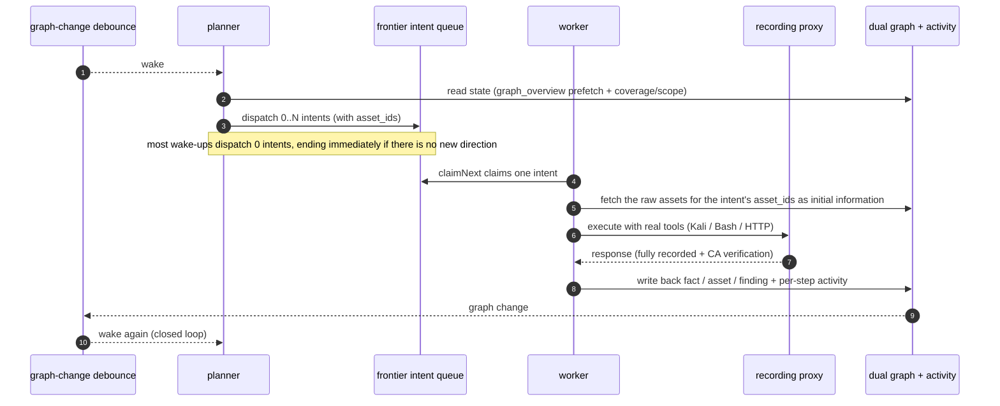
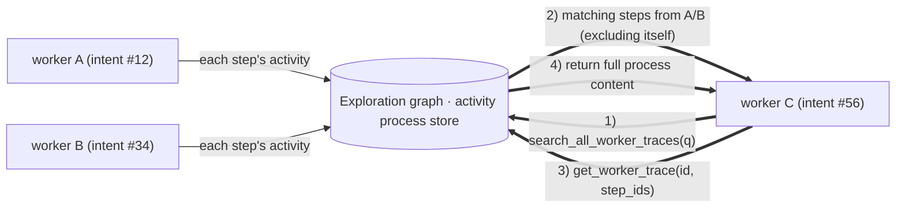
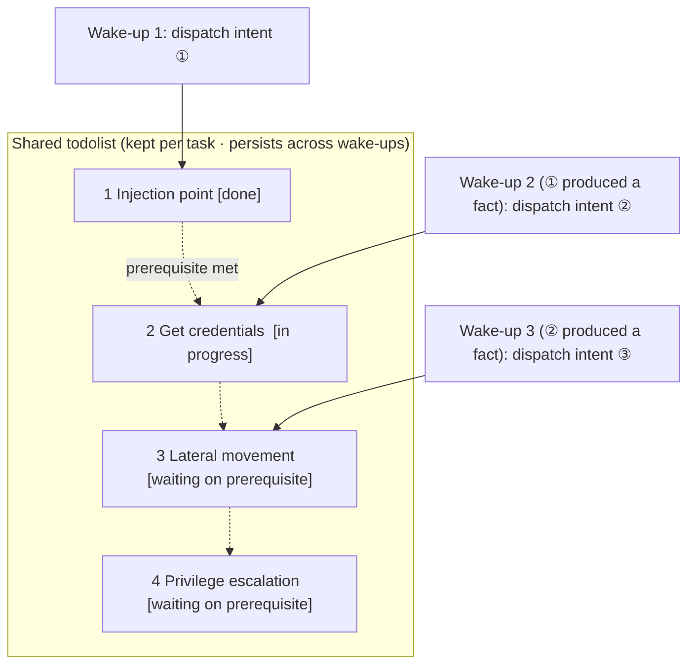

<div align="center">

# ARTEX

An autonomous AI penetration-testing system (Go backend + Next.js frontend)

[简体中文](README.md) | **English**

🌐 **Live demo (mock data):** [https://artex-demo.mhtsec.com](https://artex-demo.mhtsec.com)

📦 **This repository is a source-only backup of the last ARTEX release. The original Docker image `autumn27/artex` is no longer available; this repository now maintains its own image, `mianhuatang11/artex` (Docker Hub). If the pull fails, run `docker compose build` to build locally from source. There are no external prebuilt dependencies.**

</div>

---

## Screenshots

> For the full interactive experience, see the [live demo](https://artex-demo.mhtsec.com) (frontend only, mock data, no backend required).

| Dashboard (overview / token usage / activity feed) | Task list |
| :---: | :---: |
|  |  |

| Task execution (sessions / tool calls) | Exploration graph |
| :---: | :---: |
|  |  |

| Findings | Assets |
| :---: | :---: |
|  |  |

| Asset coverage graph (force-directed layout, tested nodes highlighted, collapsible nodes) |
| :---: |
|  |

| Traffic recording | Human-in-the-loop chat |
| :---: | :---: |
|  |  |

| Agent management | LLM configuration |
| :---: | :---: |
|  |  |

| Intercept approvals | Backend logs |
| :---: | :---: |
|  |  |

---

## Approval record details

The global "Approval records" page, the per-task "Intercept approvals" tab, and the approval cards in chat can all be expanded to show details. The layout follows
[AegisHook's approval detail component](https://github.com/RuoJi6/AegisHook/blob/main/web/src/components/CallDetail.vue), reusing ARTEX's own components and theme.

## Asset sync (ScopeSentry)

Asset data can be synced straight from [ScopeSentry](https://github.com/Autumn-27/ScopeSentry), so you don't have to collect it twice:

- On the "**Asset sync**" page, enter the ScopeSentry address and API key to connect the data source.
- Pick the targets and asset types to sync by **project** or by **task** (domain / subdomain / IP / port / site / endpoint, and so on).
- One click imports the data and merges it into the company asset scope, where it goes straight into ARTEX's asset graph for agents to explore.

---

## Installation

> Requires a **PostgreSQL** database. Exploration needs an **LLM** (`ANTHROPIC_API_KEY` or `OPENAI_API_KEY`, which can also be set in the UI).

### Option 1: one-click install script (recommended)

```bash
git clone https://github.com/mhtsec/ARTEX.git
cd ARTEX
./install.sh
```

The script detects (or installs) Docker, then lets you choose **① all-in-Docker** or **② local build and run**:

- **① All-in-Docker:** enter a Postgres password (press Enter for a random one), then it writes `.env` and runs `docker compose up -d`.
- **② Local run:** pick a database (connect to an existing one, or start one in Docker), generate `config.json`, compile the single embedded binary with `go`, and start it.

When it finishes, open **http://localhost:8787**. On first visit you are taken to `/setup` to set the admin password.

### Option 2: Docker Compose (manual)

```bash
git clone https://github.com/mhtsec/ARTEX.git
cd ARTEX
cp .env.example .env          # set POSTGRES_PASSWORD; ANTHROPIC_API_KEY is optional
docker compose up -d          # pulls the mianhuatang11/artex image + postgres
# → http://localhost:8787
```

> The original image `autumn27/artex` has been removed from Docker Hub. This repository now maintains the image as **`mianhuatang11/artex`**.
> If the image is unavailable (or you want to change the code), build locally from source: `docker compose build && docker compose up -d`.
> The Dockerfile is multi-stage (static frontend export → static Go build → runtime image). It defaults to mirrors that are friendly to networks in China. Override them with `--build-arg GOPROXY=... / --build-arg NPM_REGISTRY=...`.

The image already includes common tools (ripgrep, curl, vim, npm, nmap, and so on). `./skills` and `./data` are bind-mounted so they persist.

For remote MCP servers, choose `http` (Streamable HTTP) or `sse` (legacy SSE) in system settings.
Legacy SSE servers usually open the event stream with `GET /sse` and then accept JSON-RPC requests at the
`/message?sessionId=...` URL they return. Set the URL to `/sse` and put the header as
`Authorization=Bearer <token>`.

### Option 3: download a prebuilt binary (Releases)

Download the zip for your platform from the original repository's [Releases](https://github.com/Autumn-27/ARTEX/releases). **This backup repository does not host binaries.** If the original Releases are also gone, use Option 2 or Option 4. The archive contains `artex` + `start.sh` (`start.bat` on Windows) + `skills/` + `config.example.json`:

```bash
cp config.example.json config.json   # fill in the database connection
./start.sh                           # → http://localhost:8787
```

> Start it with `start.sh` / `start.bat`, not by running `./artex` directly. It is a supervisor script: after the program exits, it decides from the exit code whether to relaunch it, and **the in-app [one-click update](#option-1-one-click-update-from-the-ui-recommended) relies on it to swap binaries**. If you run `./artex` directly, nothing restarts it after an update.
> To keep it running in the background: `nohup ./start.sh >artex.log 2>&1 &`.

### Option 4: build the single binary from source

```bash
# 1) static frontend export
cd web && npm ci && npm run build:static && cd ..
# 2) copy it into the embed directory
cp -r web/out server/webui/dist
# 3) compile (-tags embedui embeds the frontend)
CGO_ENABLED=0 go build -tags embedui -o artex ./cmd/artex
./start.sh
```

### Option 5: build cross-platform release archives

`build.sh` builds and embeds the frontend, strips debug info with the Go linker, and packs each build into a zip. Release mode produces zips for Linux amd64/arm64, macOS amd64/arm64 and Windows amd64 by default:

```bash
./build.sh --release
# output: dist/artex-0.3.3-*.zip
```

UPX self-extracting binaries may be incompatible with some Linux kernels, virtualization environments or security policies, so UPX is off by default. Use `ARTEX_TARGETS` to choose targets. When you have confirmed that your target environment is compatible, pass `--upx` to shrink the binary further:

```bash
ARTEX_TARGETS=linux/amd64,windows/amd64 ./build.sh --release
./build.sh --target linux/amd64 --upx
```

---

## Updating

> An update replaces only the program and leaves your data alone: the Postgres volume `pgdata`, `./data` (jwt.key, SQLite, and so on) and `./skills` are all kept. **No manual database migration is needed.** `artex` re-runs `schema.sql` idempotently on every start (including `ADD COLUMN` / `CREATE INDEX IF NOT EXISTS`), so restarting migrates. Still, back up `./data` and the database before upgrading.

### Option 1: one-click update from the UI (recommended)

On the **System settings** page (sidebar "System settings" → `/system/settings`), the **Version & updates** card lets you check for and install new versions without logging in to the server.

When you click "Update": it downloads the release package for your platform → verifies it against the release's `SHA256SUMS` → smoke-tests the new binary with `-h` → stages it as `artex.new` → the program exits, and `start.sh` / `start.bat` relaunches it and completes the swap. The page waits for the new version to come online and then refreshes.

- **A failed update never leaves a broken program.** If verification or the smoke test fails, the staged file is discarded and the current version keeps running. If the new version fails to start 3 times in a row after the swap, it rolls back to `artex.old` automatically (the failed one is kept as `artex.failed` for inspection).
- **You can always roll back.** The previous version is kept as `artex.old`, and the card has a "Roll back to previous version" button. Note that the database schema is not rolled back.
- **Updating interrupts running tasks.** An update is a restart, so do it when idle.
- **Dev builds are not updatable.** When the version is `dev`, or `git describe` carries a suffix, updating is disabled so a release cannot overwrite a locally built binary.
- **In Docker only the program is replaced, not the image.** Toolchains in the image (playwright, nmap, and so on) are not upgraded, and after `docker compose up -d` recreates the container you fall back to the version bundled in the image. To upgrade the image as well, still use `docker compose pull artex && docker compose up -d artex`.
- If GitHub access needs a proxy, set the **global proxy** on the same page. The update path uses it. Updates are downloaded only from GitHub domains, over HTTPS.

### Option 2: one-click update script

```bash
cd ARTEX
./update.sh
```

The script can optionally `git pull` the latest code first, then asks you to choose **① Docker update** or **② local build update** (matching `install.sh`):

- **① Docker:** you can specify a target image tag (press Enter to keep `ARTEX_TAG` from `.env`, defaulting to `latest`) → `docker compose pull` → `docker compose up -d` (restarting on the new image migrates automatically).
- **② Local:** rebuild the static frontend → recompile `./artex` (restart the process for it to take effect).

### Option 3: Docker Compose (manual)

```bash
cd ARTEX
git pull                       # update compose / scripts (optional)
# to pin a version, set ARTEX_TAG=v0.2.0 in .env; otherwise latest is used
docker compose pull artex
docker compose up -d artex     # restart on the new image → schema migrates automatically
docker image prune -f          # clean up old images (optional)
```

### Option 4: prebuilt binary (Releases)

Download the new zip from [Releases](https://github.com/Autumn-27/ARTEX/releases), stop the old process, overwrite `artex` and `skills/` (keep your `config.json` and `data/`), and restart:

```bash
cp -r <extracted-dir>/skills ./ && cp <extracted-dir>/artex ./
./start.sh
```

### Option 5: build from source

```bash
git pull
cd web && npm ci && npm run build:static && cd ..
cp -r web/out server/webui/dist
CGO_ENABLED=0 go build -tags embedui -o artex ./cmd/artex
# restart ./start.sh
```

---

## Configuration

**Database** (`config.json`, or override with the `ARTEX_PG_DSN` environment variable):

```json
{
  "database": {
    "host": "127.0.0.1", "port": 5432,
    "user": "artex", "password": "yourpass",
    "dbname": "artex", "sslmode": "disable"
  }
}
```

**LLM:** `export ANTHROPIC_API_KEY=sk-...` (or `OPENAI_API_KEY`). You can also fill it in on the UI's "LLM configuration" page.
Optional variables: `ARTEX_LLM_PROVIDER` / `ARTEX_LLM_MODEL` / `ARTEX_LLM_BASE_URL` / `ARTEX_LLM_PROXY`.

- `ARTEX_LLM_PROVIDER` accepts `anthropic`, `openai` (Chat Completions format, also used by most OpenAI-compatible gateways) and `openai-responses` (Responses API). If left empty, it is inferred from whichever API key is set.
- Streaming is on by default. `ARTEX_LLM_STREAM=false` turns it off.

**Concurrency:** the number of work agents per task is set in "System settings" (default 3).

**Common flags:** `./start.sh -addr :8787 -proxy :8788` (`-addr` is frontend + API, `-proxy` is the traffic-recording proxy). The startup script passes arguments through to `artex` unchanged.

### Reverse-proxy deployment (HTTPS / expose only 443)

The frontend and the API/SSE are served from the same backend port (default `:8787`). The live activity stream uses a **same-origin** address by default, so you **do not need to set `NEXT_PUBLIC_SSE_BASE`**. You can expose only 443 publicly and keep 8787 on the internal network.

SSE is a long-lived, continuously pushing connection, so the reverse proxy **must disable buffering**. Otherwise the browser connects but never receives events, and the activity stream spins forever. Nginx example:

```nginx
server {
    listen 443 ssl;
    server_name your.domain.com;
    # ssl_certificate / ssl_certificate_key ...

    location / {
        proxy_pass http://127.0.0.1:8787;
        proxy_set_header Host $host;
        proxy_set_header X-Forwarded-Proto $scheme;

        # SSE essentials: no buffering, long timeout, HTTP/1.1
        proxy_buffering off;
        proxy_cache off;
        proxy_read_timeout 3600s;
        proxy_http_version 1.1;
        proxy_set_header Connection "";
    }
}
```

> Set `NEXT_PUBLIC_SSE_BASE` at **build time** only if SSE must come from a different origin than the page (for example a separate subdomain). The variable is baked into the static bundle during `next build`, so setting it when the container runs has no effect.

---

## Development

### Manual vulnerability retest

On the "Retest" tab of the task detail page you can page through the task's findings, view past conclusions and evidence, and start a manual retest. After you start one, the current tab stays open and shows a spinner with "Retesting". When a fix is confirmed, the finding's status is updated to match.

Click "Retest" in the action area of any row in the findings list, or "Start retest" in the "Finding retest" section of the finding detail. You can fill in an optional fixed version, test conditions or restrictions. The system creates a separate retest agent session and keeps you on the current page. The flat, grouped-by-task and by-asset views of the list all offer this entry point. While a retest runs, the row shows a spinner and "Retesting". Click it to open the session, and when it finishes it goes back to "Retest". You don't need to restart the original scan task. Conclusions are "Still reproducible", "Fixed" or "Cannot confirm". Each run's conclusion, evidence and session link are saved in the finding detail.

On first start, a new backend seeds an editable "Vulnerability retest" (`retester`) agent. Its prompt, LLM, run budget and tools can be configured in Agent management. It uses its bound LLM by default, and falls back to the globally active configuration if none is bound. When a retest session completes successfully with the conclusion "Fixed", the system automatically sets the finding's disposition to "Fixed". If the run is in progress, failed, stopped, or has any other conclusion, the existing status is kept. The original evidence and report are always preserved. You can also choose "Fixed" manually from the status dropdown. If a finding is already being retested, the existing session is reused. After a stop, a failure or a service restart you can start another one.

In this version the history is viewed through the finding detail and sessions. It is not yet included in vulnerability report exports or task archive packages, and it is not automatically linked to traffic captures. Demo mode only produces clearly labeled simulated records and never contacts real targets.

### Running and testing locally

```bash
./dev.sh    # backend (:8787) + traffic proxy (:8788) + frontend next dev (:5173) → http://localhost:5173
```

- Backend: `go run ./cmd/artex` (without `-tags embedui` the frontend is not embedded)
- Frontend: `cd web && npm run dev` (`/api` is proxied to the backend, with hot reload)
- Tests: `go test ./...` (many database tests need a reachable PostgreSQL and skip themselves otherwise)
- Mock preview (no backend): `cd web && NEXT_PUBLIC_MOCK=1 npm run dev`
- Redeploying the live demo (Cloudflare Pages, static export + mock data):
  ```bash
  cd web && NEXT_PUBLIC_MOCK=1 npm run build:static
  CLOUDFLARE_API_TOKEN=<token> npx wrangler pages deploy out --project-name=artex-demo --branch=main
  ```

---

## System architecture

ARTEX is an **LLM-driven multi-agent autonomous penetration system**: a single Go backend (with the Next.js frontend embedded) plus PostgreSQL. Agent capabilities come from the [`norma`](https://github.com/Autumn-27/norma) SDK (`agentcore` / `tool` / `permission` / `harness` / `memory` / `transcript`), vendored in this repository under `./norma`. The core is a **dual-graph architecture**, plus two mechanisms that make the agents autonomous: **process-level information exchange between workers** and a **multi-round shared planner todolist that keeps attack chains stable**.

### Overall layers



| Layer | Responsibility |
| --- | --- |
| **Frontend** | Next.js static export, embedded into the single binary with `go:embed`. Visualizes tasks, assets, exploration chains and the coverage graph, with human-in-the-loop chat |
| **server** | `net/http` routing + JWT auth + SSE. `Manager` owns the lifecycle of tasks, engines and DB stores |
| **engine** | One `plannerLoop` plus N worker goroutines per task. Handles intent claiming, timeouts, pause and drain |
| **agent** | goals / planner / worker / mainagent. `ToolSet` exposes the dual graph to the LLM as tools |
| **db** | Postgres persistence of the dual graph (pgx). The schema is embedded with `go:embed` and created idempotently on every start |
| **Supporting** | Recording MITM proxy, approval gate, async enrichment, MCP / skills / memory / reports |

### Dual-graph architecture: exploration graph + asset graph

The system splits "**what the target is**" from "**how far we've tested it**" into two independent graphs joined by anchors:

- **Asset graph (global, shared):** a single source of truth for assets across all tasks. Nodes are `root_domain / subdomain / ip / service / app / endpoint`, each owned by a company. The parent-child relationships (domain → subdomain → service → endpoint) and the dedup keys are all computed by the program. Agents only submit raw information.
- **Exploration graph (per task):** the "thinking and progress" of a single task. Nodes are `goal / intent / fact / finding / hint`, linked by edges such as `spawns / derived_from / yields / proves` into a **lineage chain**. It answers "which direction was derived from which facts, and what did it produce".
- **The two graphs are joined by anchors.** `exploration_anchors(node_id, asset_id)` anchors intents, facts and findings to specific assets. From an exploration direction you can see which assets it targeted. From an asset you can look up which intents tested it in this task and which facts came out of it. This also underpins **asset test coverage** and the **asset coverage graph** (in-scope assets with tested ones highlighted).



> Division of labor: the **planner** reads the state of the exploration graph, judges the goal, and dispatches **intents** to the frontier only when there are new, uncovered directions. A **worker** claims **one intent**, executes it with real tools, writes new assets, facts and findings back to both graphs, and then stops. The asset graph holds shared facts. The exploration graph is each task's progress chain.

### Engine and intent lifecycle (one closed loop of exploration)

The engine is an **event-driven** closed loop. Any change to the graph wakes the planner, the planner dispatches intents, workers claim and execute them and write results back, and the writes trigger the next round. It continues until the goal is proven (`prove_goal`).



### Process-level information exchange between workers

In a deep exploration, many valuable observations (an error message, a response body, a hidden parameter) appear during one worker's **execution** without necessarily being written up as a formal fact. To avoid duplicated effort and let workers on the same chain build on each other's work, a worker can **search other workers' processes**:

- `search_all_worker_traces(q)`: keyword search across the **execution processes of the other works in this task** (automatically excluding the steps of its own intent). Hits carry an `intent_id`.
- `list_worker_traces` / `get_worker_trace(intent_id, step_ids=[…])`: first see which works have run, then fetch the full content of specific steps from one of them for detailed exchange.

So even when the exploration graph has no matching fact yet, later workers can reuse observations from others' processes. **Information flows between workers at the granularity of "execution process"**, while the boundary stays the same: each worker still does only the one intent it claimed.



### Shared multi-round planner todolist → stable attack chains

Real attack chains are often **ordered, multi-step sequences with dependencies** (for example: find an injection point → get credentials → move laterally → escalate privileges). Dispatching all of them in parallel at once would be chaos. So the planner holds a **planning todolist that is kept per task and shared across wake-ups**:

- The planner is event-driven: any graph change wakes it, but **each wake-up is a fresh session**. The shared todolist lets it **record a serial exploitation chain once**, then **dispatch intents step by step as dependencies are met** over later rounds, instead of expanding the whole chain up front in a single round.
- In each round it dispatches intents only for the next step whose prerequisites are done and whose required facts already exist, and updates the list as things progress (marking a step done once a fact satisfies it).



In an "event-driven + stateless session" environment, the attack chain still **advances steadily, without repeating or running out of order**. This is what lets ARTEX autonomously complete multi-step exploitation chains.

---

## Community

Follow the WeChat official account **SecSentry**, and send a private message from the account to be added to the discussion group.

<div align="center">


</div>

---

## References

https://github.com/oritera/Cairn

## License and disclaimer

### Open-source license

This project is licensed under the **GNU Affero General Public License v3.0 (AGPL-3.0)**. See the [LICENSE](LICENSE) file in the repository root for the full terms.

This means anyone may freely use, modify and distribute the project, but **derivative works must also be open-sourced under AGPL-3.0**. In particular, **if you modify the project and offer it to users over a network (for example, deployed as an online service), you must also make the complete corresponding source code available to those users.**

> ⚠️ **Important:** an open-source license by itself does not restrict how software is used. The "usage restrictions" and "disclaimer" below are additional terms and a formal statement from the author to users. Please observe them.

**ARTEX is for personal study, code research and local technical verification only. It must not be used to run actual tests against any online system or website.**

### Permitted use

- Reading, studying and researching the source code of this project, and verifying technical principles in a **local, isolated environment**.
- Personal learning, academic research, code review and other non-offensive purposes.

### Prohibited use

- **Do not use this tool to scan, probe, exploit or attack any website, online service or networked system** (whether or not you are authorized, and whether or not the system is your own).
- Do not use this tool for any real penetration test, attack-defense exercise or production environment.
- Do not use this tool for illegal intrusion, data theft, extortion, denial of service, or any destructive or criminal activity.
- Do not use this tool for any act that violates the laws and regulations of your country or region.

### Compliance responsibility

Users must comply with all laws and regulations on cybersecurity, data protection and computer crime that apply in their country or region (in mainland China, including but not limited to the Cybersecurity Law, the Data Security Law, the Personal Information Protection Law and the related judicial interpretations). **All legal liability and consequences arising from use of this tool are borne by the user.**

### Disclaimer

This project is provided "AS IS", without warranty of any kind, express or implied. The author and contributors accept no liability for any direct or indirect loss, data loss, system damage or legal dispute resulting from the use of this tool, whether or not it is used properly. **By downloading, installing or using this project, you indicate that you have read, understood and agreed to all of the above terms.**
