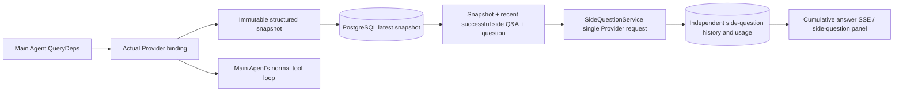

# ARTEX `/btw`

Regular chat, the task MainAgent, and the current task's own Worker all support independent side questions. Type `/btw <question>` in the main input box to submit; an empty `/btw` or the “Side Questions” button opens the history. Desktop uses a resizable side panel, mobile uses a Drawer.

Side-question answers are generated from a snapshot of the Agent's context taken at submission time, and support streaming display, follow-up questions, stopping, and clearing. Closing the panel, refreshing the page, or disconnecting the SSE connection does not cancel the model request. Stopping only affects the current side question; clearing cancels the side question and deletes the side-question history while keeping the main context snapshot.

## Implementation Boundaries

Builds on Go, norma v0.3.7, Next.js, and the existing Markdown / ResizablePanel / Drawer / AlertDialog components; norma's source was not modified and no dependencies were added for side questions. The Planner, Workers inherited from other tasks, and tool-type subtask upgrades are out of scope for this effort.

- `capture.go` only marks main-loop requests inside `Options.Deps.CallModel / CallModelSync`. The Provider decorator sits inside the concrete model, after the routing pool's outer selection, so it records the actually selected model; compaction and summarization requests do not overwrite the snapshot.
- A snapshot is published at request start, on a complete model reply, and at run termination. A half-generated reply in progress is not published; tool calls stay paired via norma's `MessagesForAPI`, and tool results enter the snapshot on the next main-model request or at run termination. A streaming abort retains the last valid boundary.
- The snapshot preserves structured messages, the system prompt, tool definitions, and generation parameters via a JSON deep copy. Model inference does not hold a snapshot lock or a database transaction.
- `SideQuestionService` calls the concrete Provider; when necessary it first generates a side-question summary, and the final answer is allowed one reduced retry only if the first attempt hits a context overflow before any text/tool call has been output. It does not create an agent session, and does not hook into the tool executor, the main transcript, the activity stream, or the task graph, nor does it go through the task's model-switching chain. The answer retains tool definitions for compatibility with the existing structured tool context; summarization requests are not given tools. Any tool call newly returned has no execution path.
- One running request per parent session, up to four per service process, with a 120-second timeout per request. Side questions use an independent cancellation context scoped to the service lifecycle.
- Side-question requests keep a reference to the model configuration and a non-sensitive identity summary; credentials are fetched from the existing configuration at request time. If the configuration is deleted, or identity fields such as model, protocol, or address change, the main Agent must be run first to update the snapshot. Tests do not change the product's default model.

## Persistence and Recovery

`db/schema.sql` automatically creates `side_question_sessions` and `side_question_requests`. The former stores the parent resource, the latest snapshot, the run ID, the version, and the cleanup version; the latter stores the question, the cumulative answer, status, model, snapshot time, usage, event sequence, and pagination ordinal.

The parent session key uses the conversation ID, or task ID + exploration ID + intent ID. Workers do not use reusable execution-slot naming.

Snapshots are merged and written per parent session, flushed at most every 250 ms, and the database compares `(run_id, version)` to prevent an older version from overwriting a newer one. The selected snapshot is saved again before a side-question submission. After a successful save, the large in-memory snapshot is released; on failure, the pending version is kept. The cumulative answer content is written at most every 250 ms as streaming events arrive; the terminal state is saved immediately and retried a limited number of times on database errors.

On service startup, any leftover `running` requests are marked `interrupted`, keeping the partial answer and usage already persisted, without automatically replaying the request. The most recently saved context can be used directly for the next question. If an old session has no snapshot, the main Agent must be run first; context is not reconstructed from the UI activity log.

A clear operation increments the cleanup version and deletes the requests; a conditional update blocks late callbacks from writing back. Physical deletion of the parent resource relies on foreign-key cascades; a Worker's soft delete removes side-question data within the same transaction and rejects any subsequently late snapshot. Task archiving first blocks new requests, waits for the main flow to stop, then cancels and waits for the side question to persist; the archive format is v3, while remaining compatible with v1/v2, which lack the side-question tables.

History is fully preserved, with up to 20 items returned per page via a sequence cursor. Model requests replay the raw text of at most the most recent 20 successful Q&A pairs, also bounded by a token budget; older Q&A pairs are maintained in a separate rolling summary. When the main context exceeds budget, only the older part of the side-question's own copy is summarized, keeping recent structured tool calls and results intact. Summarization and preparation progress, together with usage, are subject to the same concurrency, cancellation, and 120-second timeout limits as the side question. See [Context Budget and Open-Source References](CONTEXT_BUDGET.md) for details.

## HTTP Contract

The following paths serve as `{parent}`, reusing existing authentication and resource validation:

- `/api/conversations/{id}`
- `/api/tasks/{id}/chat`
- `/api/tasks/{id}/intents/{iid}`

| Request | Response and behavior |
| --- | --- |
| `GET {parent}/side-questions?before={ordinal}` | `items` ordered newest to oldest, an independent `current` run status, `snapshot` metadata, `next_cursor`; a cursor of 0 means the latest page / no next page |
| `POST {parent}/side-questions` | JSON `{ “question”: “…”, “client_request_id”: “UUID” }`; a new request returns 202 with the request object; the same ID and question returns the existing object with 200 |
| `DELETE {parent}/side-questions` | Cancels and clears the current parent session's side-question Q&A |
| `GET /api/side-questions/{requestID}/events` | `snapshot` SSE events, `id` is an incrementing sequence number, `data` is the full cumulative request object; sends `cleared` when cleared |
| `POST /api/side-questions/{requestID}/cancel` | Explicit cancellation; the terminal state can be read from history or SSE |

Questions are capped at 4000 characters. Returns 409 when there is no snapshot, the model configuration has changed, the same parent session is busy, or there is an idempotency-ID conflict; returns 429 when the global concurrency limit is reached. Every SSE connection first sends the cumulative state, without relying on text fragments the client previously received. The frontend merges by request ID + sequence number, and discards stale callbacks when switching parent sessions or clearing.

## Validation and References

See [VALIDATION.md](VALIDATION.md) for automated checks, real model usage, and known limitations.

Independent requests reference [Grok CLI side-question.ts (pinned commit)](https://github.com/superagent-ai/grok-cli/blob/fb97af83f06dca873281d60168430f06c8de6324/src/utils/side-question.ts), and run isolation references [OpenCode (pinned commit)](https://github.com/anomalyco/opencode/tree/b3f1a96c6dd7adeb28b36dd11add1998fc84d67b). ARTEX's context uses norma's structured messages, and does not use the approach of concatenating text from frontend logs.
