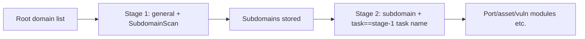

---

## name: scopesentry-mcp
description: Manage the security scanning platform (projects, tasks, templates, assets, nodes) via ScopeSentry MCP. Use when the user mentions ScopeSentry, MCP, API Key, scan tasks, or asset queries.

# ScopeSentry MCP Usage Guide

For users with an **already-deployed ScopeSentry instance**. Connect to the platform via Cursor (or another MCP client) — no local source code required.

## 1. Preparation

### 1.1 Confirm the service is reachable

- Default web UI: `http://<host>`
- MCP endpoint: `http://<host>/mcp` (if there's a reverse proxy or frontend proxy in front, use the actual `/mcp` address)

### 1.2 Create an API Key

1. Log in to the ScopeSentry web UI in your browser
2. Go to the **API Key** management page and create a key (or have an admin create one via the provided interface)
3. Save the returned `ssk_...` string (**shown only once**)

### 1.3 Configure Cursor MCP

Cursor → Settings → MCP → Add server:

```json
{
  "mcpServers": {
    "scopesentry": {
      "url": "http://<your-host>:8082/mcp",
      "headers": {
        "X-API-Key": "ssk_your_key"
      }
    }
  }
}
```

You can also use: `Authorization: Bearer ssk_your_key`

After configuring, restart MCP or reload Cursor, and confirm that `list_projects`, `list_assets`, etc. appear in the tool list.

---

## 2. Tool Overview


| Tool                   | Purpose             |
| ---------------------- | ----------------- |
| `list_projects`        | Project tree grouped by tag (includes project IDs) |
| `list_projects_data`   | Paginated project list, searchable by name |
| `get_project`          | Project details |
| `create_project`       | Create a new project |
| `list_tasks`           | Scan task list |
| `get_task`             | Task details |
| `list_scan_templates`  | Scan template list |
| `get_scan_template`    | Template details |
| `list_plugin_modules`  | Scan pipeline module names |
| `list_plugins`         | Available plugins (including hash, default parameters) |
| `create_scan_template` | Create a scan template |
| `create_scan_task`     | Create a scan task |
| `list_assets`          | Query assets of various types (paginated list) |
| `count_assets`         | Count assets (`/api/assets/common/total`) |
| `get_asset_detail`     | Asset or vulnerability details |
| `add_asset_tag`        | Add a tag to an asset |
| `list_nodes`           | Scan node list |


Each tool's parameters follow its MCP tool description (schema); `list_assets` / `count_assets` share the same search/filter syntax, so you can read the `list_assets` description before querying assets.

When you need to know "how many total records", use `count_assets` (which maps to the web pagination total-count endpoint) instead of repeatedly paging through `list_assets` just to count.

---

## 3. Common Workflows

### 3.1 Query assets by project

When the user or context **already has a project condition**, prefer including `filter.project` to narrow the scope and avoid slow responses from too much cross-project data. If there's no explicit project, you don't need to force a project filter.

1. Use `list_projects` or `list_projects_data` to get the target project's **ObjectID** (`id` / `children[].value`)
2. Pass `filter.project` to `list_assets` (**must be the ID, not the project's display name**)

```json
{
  "asset_type": "asset",
  "pageIndex": 1,
  "pageSize": 20,
  "search": "domain=^example.com",
  "filter": {
    "project": ["<projectObjectID>"]
  }
}
```

### 3.2 Create a scan task

1. Use `list_nodes` to get the names of online nodes
2. Use `list_scan_templates` or `create_scan_template` to get the template **ObjectID**
3. `create_scan_task`: `name` and `node` are required; `template` must be the template ID (not the template name)

**Target source `targetSource` (consistent with the web UI):**

| targetSource | Description | Required parameters |
| --- | --- | --- |
| `general` | Enter targets directly | `target` |
| `project` | Read targets from a project | `project` (array of project ObjectIDs) |
| `asset` | Search the web asset library | `search`; optional `project`, `filter`, `targetNumber` |
| `RootDomain` | Search the root domain library | `search`; optional `project`, `filter`, `targetNumber` |
| `subdomain` | Search the subdomain library | `search`; optional `project`, `filter`, `targetNumber` |
| `UrlScan` | Search URL scan results | `search`; optional `project`, `filter`, `targetNumber` |
| `*Source` (e.g. `subdomainSource`) | Create from "select/search" on the asset page | Use `search` when `targetTp=search`; use `targetIds` when `targetTp=select` |

**Example — scan root domains directly:**

```json
{
  "name": "example-subdomain-collection",
  "node": ["node-1"],
  "template": "<templateObjectID>",
  "targetSource": "general",
  "target": "example.com\nfoo.com",
  "project": ["<projectObjectID>"]
}
```

**Example — continue scanning from the subdomain library (filtered by the previous task's name):**

```json
{
  "name": "example-ports-and-vulns",
  "node": ["node-1"],
  "template": "<followUpModuleTemplateObjectID>",
  "targetSource": "subdomain",
  "search": "task==\"example-subdomain-collection\"",
  "project": ["<projectObjectID>"]
}
```

### 3.3 Full information gathering on a root domain (two-stage approach recommended)

When the input is a **root domain** and you need **full information gathering**, it's best to run two separate scans rather than the whole pipeline at once.

**Why:** Distributed tasks are dispatched per **individual target**. When a root domain is used as the target, once a node is assigned that root domain, any subdomains discovered on that node will also continue to run subsequent modules on the same node — which tends to cause uneven load, slow speed, and more errors.

**Best practice:**

1. **Stage 1 — subdomain collection only**
   - `targetSource`: `general`
   - `target`: all root domains (one per line)
   - Template: enable only `SubdomainScan` and `SubdomainSecurity` (subdomain scanning + subdomain takeover detection)
   - Use `get_task` to wait for the task to finish

2. **Stage 2 — follow-up modules**
   - `targetSource`: `subdomain`
   - `search`: `task=="<stage-1 task name>"` (exact match on task name)
   - Optionally add `project` to narrow the scope
   - Template: port scanning, asset mapping, vulnerability scanning, etc. (can exclude SubdomainScan)
   - Subdomains are dispatched to nodes as independent targets, giving better parallel efficiency

You can achieve the same result in the web UI by filtering the "Subdomain" asset page by task name and using "Create task from subdomains".



### 3.4 Create a scan template

1. `list_plugin_modules` → list of module names
2. `list_plugins` (filterable by `module`) → each plugin's `hash` and default `parameter`
3. `create_scan_template`: use `modules` to specify "module → array of plugin hashes"

---

## 4. Asset Queries (`list_assets` / `count_assets`)

`count_assets` uses the same `asset_type`, `search`, and `filter` as `list_assets`, and returns `{ "total": N }`, corresponding to the web UI's `/api/assets/common/total`.

```json
{
  "asset_type": "subdomain",
  "search": "task==\"some task name\"",
  "filter": {"project": ["<projectObjectID>"]}
}
```

**Performance tips (apply to both `list_assets` and `count_assets`):** When there's a project condition, prefer `filter.project` to narrow scope; for indexed fields in `search`, prefer `==` exact match or `^` prefix match (see [4.3](#43-the-search-search-expression)) over broad `=` fuzzy queries, which slow down responses. Don't force a project filter when there's no project context.

See the table in [4.4](#44-filter-exact-match-filtering) for which types support `filter.project`.

### 4.1 Asset type `asset_type`

`asset`, `RootDomain`, `subdomain`, `app`, `mp`, `UrlScan`, `SensitiveResult`, `DirScanResult`, `crawler`, `vulnerability`, `PageMonitoring`, `IPAsset`, `SubdomainTakerResult`

Alias examples: `web`→asset, `vuln`→vulnerability, `ip`→IPAsset, `url`→UrlScan

### 4.2 Parameters


| Parameter                 | Description                              |
| ------------------------ | --------------------------------------- |
| `pageIndex` / `pageSize` | Pagination, defaults to 1 / 20          |
| `search`                 | Search expression (see below)            |
| `filter`                 | Exact-match filter JSON (see below)      |
| `sort`                   | Only UrlScan and DirScanResult support sorting by `length` |
| `sid`                    | SensitiveResult only: sensitive rule name |


`search` and `filter` **can be used together**.

### 4.3 The `search` search expression

A custom DSL (**not SQL**):


| Operator | Meaning | Indexed | Example |
| ---- | ---- | ---- | --------------------------- |
| `=`  | Fuzzy match (regex) | Not indexed | `domain=example`            |
| `==` | Exact match | **Indexed** | `port==443`                 |
| `!=` | Exclude | — | `port!="80"`                |
| `&&` | AND  | — | `domain==example.com && port==443` |
| `||` | OR   | — | `title=admin || body=login` |


**Indexing and operators:** Fields like `domain`, `ip`, `port`, and `title` are indexed, but only **`==` exact match** or **prefix match where the value starts with `^`** (e.g. `domain=^example.com`) can use the index; **`=` is translated into a regex fuzzy match and cannot use the index**, which tends to be slow on large datasets.

**Search fields common to all types:** `tag`, `task` (task name), `rootDomain`

**`project` cannot be used in `search`** (it's invalid, or errors when combined with `&&`). To filter by project, use `filter.project`.

**Commonly used search fields per type:**


| asset_type           | Fields                                                                                  |
| -------------------- | ----------------------------------------------------------------------------------- |
| asset                | domain, ip, port, service, app, title, statuscode, icon, banner, type, body, header |
| RootDomain           | domain, icp, company                                                                |
| subdomain            | domain, ip, type, value                                                             |
| app                  | name, icp, company, category, description, url, apk                                 |
| mp                   | name, icp, company, category, description, url                                      |
| UrlScan              | url, input, source, resultId, type                                                  |
| SensitiveResult      | url, sname, body, info, md5                                                         |
| DirScanResult        | url, statuscode, redirect, length                                                   |
| vulnerability        | url, vulname, matched, request, response, level                                     |
| crawler              | url, method, body, resultId                                                         |
| PageMonitoring       | url, hash, diff, response                                                           |
| IPAsset              | ip, domain, port, service, webServer, app                                           |
| SubdomainTakerResult | domain, value, type, response                                                       |


**search examples:**

- `domain==www.example.com && port==443` (exact match, indexed)
- `domain=^example.com` (prefix match, indexed)
- `ip==192.168.1.1`
- `task=="some task name"`
- `level==high` (vulnerability)
- `statuscode==200` (DirScanResult)

Only use `=` when you actually need a fuzzy/contains match, e.g. `title=admin` (not indexed — best combined with a project condition or similar to narrow scope).

### 4.4 `filter` exact-match filtering

A JSON object: multiple values under the same key are **OR**'d; different keys are **AND**'d.

**Prefer `project` when there's a project condition:** if the user or context has specified a project and the asset_type supports `project`, include it to narrow scope; don't force it when there's no project information.


| filter key   | Meaning    | Value notes                                                 |
| ------------ | -------- | -------------------------------------------------------- |
| `project`    | Owning project | **ObjectID**, obtained via `list_projects` / `list_projects_data` |
| `task`       | Source task | **Task name**, the `name` from `list_tasks`                      |
| `port`       | Port       | e.g. `"443"`                                                |
| `service`    | Service/protocol | e.g. `"https"`                                              |
| `app`        | App fingerprint | e.g. `"Nginx"`                                              |
| `icon`       | Icon hash  |                                                          |
| `statuscode` | HTTP status code | Mainly used for asset                                               |
| `status`     | Status     | UrlScan/DirScan HTTP code; vuln/sensitive-info processing status                       |
| `level`      | Vulnerability level | critical / high / medium / low / info                    |
| `type`       | Type       | e.g. subdomain record type A, CNAME                                         |
| `color`      | Sensitive rule color | SensitiveResult                                          |
| `sname`      | Sensitive rule name | SensitiveResult                                          |
| `tags`       | Tags       |                                                          |


**Available filter keys per type:**


| asset_type                            | filter key                                                      |
| ------------------------------------- | --------------------------------------------------------------- |
| asset                                 | project, port, service, app, icon, statuscode, type, task, tags |
| RootDomain                            | project, tags                                                   |
| subdomain                             | project, type, task, tags                                       |
| app / mp                              | project, tags                                                   |
| UrlScan                               | status, tags                                                    |
| DirScanResult                         | status, tags                                                    |
| SensitiveResult                       | status, color, sname, tags                                      |
| crawler                               | project, task, tags                                             |
| vulnerability                         | project, level, status, task, tags                              |
| PageMonitoring / SubdomainTakerResult | tags                                                            |
| IPAsset                               | project, port, service, app                                     |


**filter example:**

```json
{"project": ["<projectObjectID>"], "port": ["443"]}
```

**Combined query example:**

```json
{
  "asset_type": "asset",
  "search": "domain=^baidu && port==443",
  "filter": {"project": ["<projectObjectID>"]},
  "pageIndex": 1,
  "pageSize": 10
}
```

**Notes:**

- When there's a project condition, prefer including `filter.project` (if supported); don't force it when there's no project context
- Don't put the project's display name in `filter.project`
- Use `==` for known values and `^` for prefixes; avoid overusing `=` fuzzy matching on large tables
- For UrlScan's HTTP status, use `filter.status`; for DirScanResult, you can use `statuscode==200` in search
- For SensitiveResult, filter by rule name: use `sname=ruleName` in search, or `filter.sname`

### 4.5 Sorting with `sort`

Only **UrlScan** and **DirScanResult** support it:

```json
{"length": "ascending"}
```

Other types ignore `sort` and default to sorting by time.

---

## 5. Scan Template Module Names

`TargetHandler`, `SubdomainScan`, `SubdomainSecurity`, `PortScanPreparation`, `PortScan`, `PortFingerprint`, `AssetMapping`, `AssetHandle`, `URLScan`, `WebCrawler`, `URLSecurity`, `DirScan`, `VulnerabilityScan`, `PassiveScan`

---

## 6. Troubleshooting


| Symptom     | Fix                                                 |
| --------- | -------------------------------------------------- |
| No tools in MCP | Check the URL, API Key, and whether ScopeSentry is running |
| 401 / 403 | Recreate or replace the API Key                                    |
| Can't find assets | Confirm `filter.project` is an ObjectID; don't put project in search |
| Template/task creation fails | `template` must be the template ObjectID; `node` must be an online node name |
| Queries slow/stuck | Add `filter.project` when there's a project; switch search on indexed fields to `==` or `^` prefix and avoid `=`; reduce `pageSize` |


---

